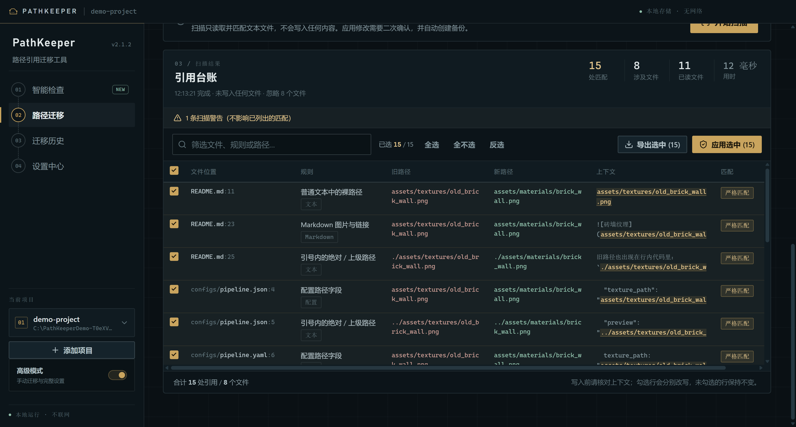
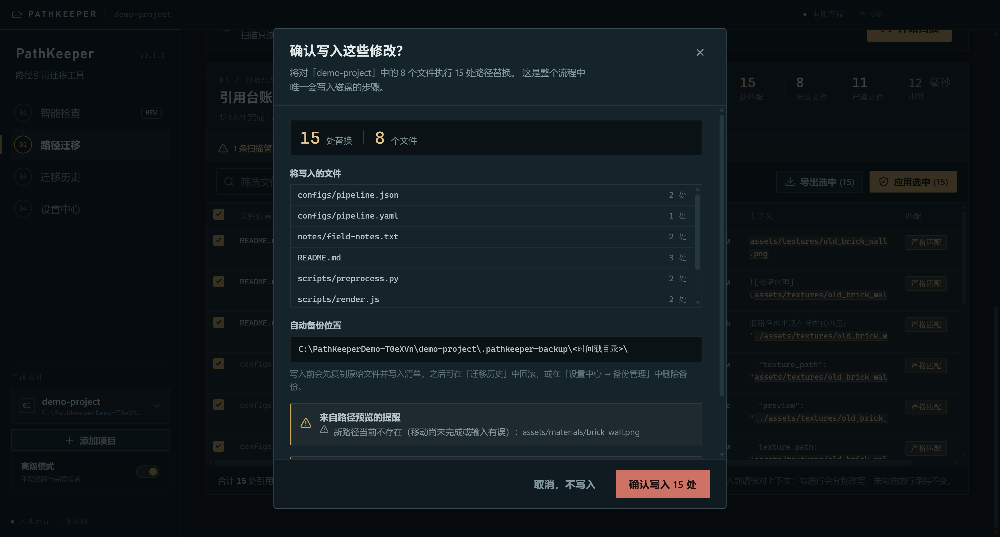
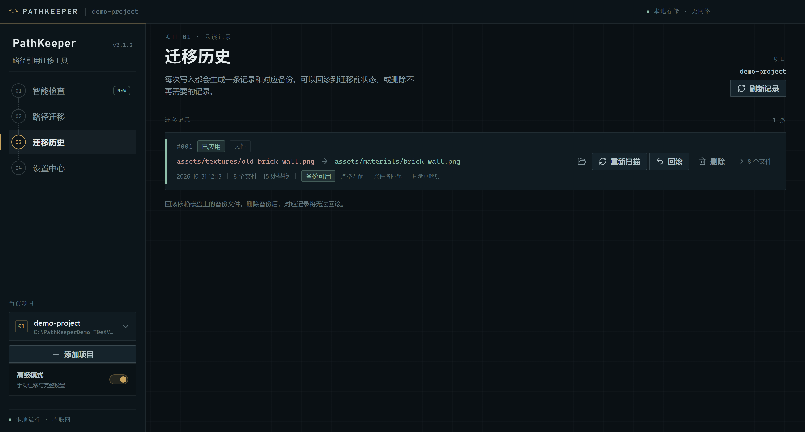
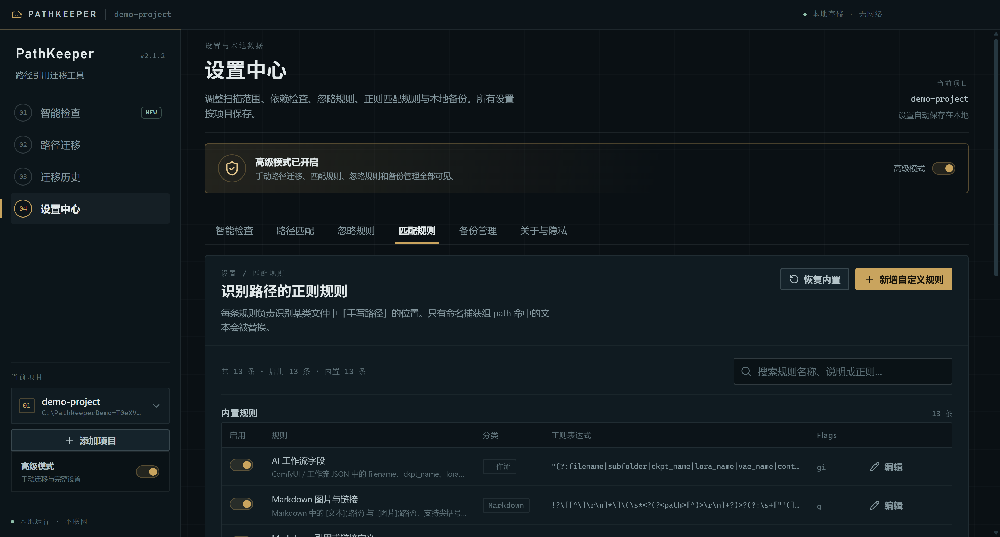
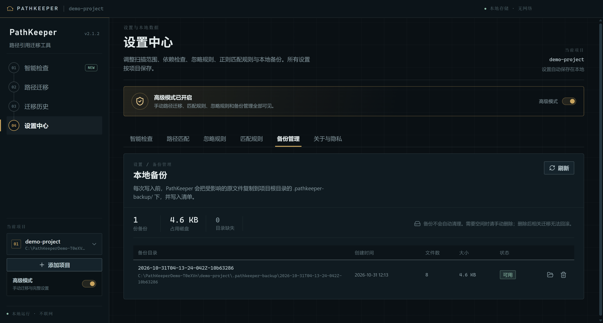
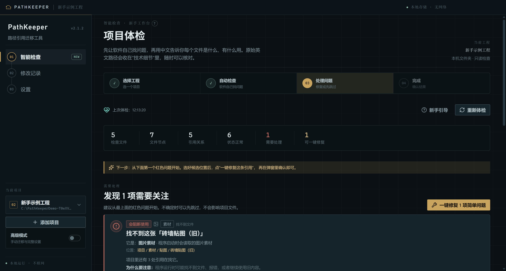
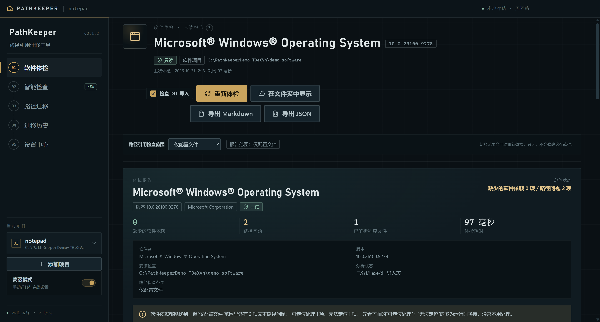
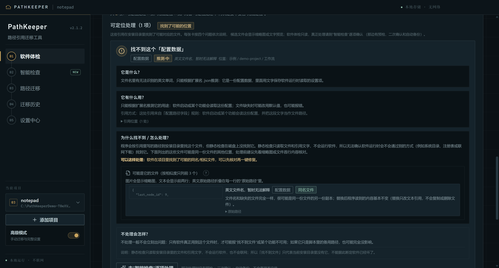

# PathKeeper

**跨文件、跨格式、不限代码语言的全局项目路径引用追踪与自动修复桌面工具。**

你在资源管理器、Git、脚本或任何其他软件里移动/重命名文件之后，PathKeeper 会扫描项目里的
代码、配置、文档、数据集清单、AI 工作流和纯文本，找出所有手写的旧路径引用；你在表格中逐条
核对、勾选，再一次性写入，并自动留下可回滚的时间戳备份。

它不接管文件操作，不依赖 IDE，不监听文件系统，也不上传任何数据。

2.1 起，除了“扫描我的项目”，还可以直接选一个已安装的**软件**（`.exe`、快捷方式或安装目录）做只读体检：找出它依赖却缺失的 DLL，以及安装目录里配置/脚本中的路径问题。**不会启动这个软件，也不会自动下载 DLL。**

[](#隐私与安全)
[](#系统要求)
[](https://www.electronjs.org/)
[](https://www.sqlite.org/)
[](LICENSE)


## 它解决什么问题

路径修复工具通常只能覆盖一种场景：Markdown 链接检查器只懂 Markdown，IDE 重构只改当前
编辑器的语义导入，脚本工具只支持固定语法。真实项目是混合的：一个纹理文件可能同时被
Python 脚本、JSON 配置、HTML 页面、ComfyUI 工作流、Markdown 文档和一份纯文本交接记录
引用。

PathKeeper 用**可编辑的正则规则 + 路径归一化 + 人工确认**来覆盖这种混合项目。它只替换
文本中检测到的路径片段，不会重写整个文件。

| 场景 | 常见工具 | PathKeeper |
| --- | --- | --- |
| 任意软件移动文件后修引用 | 不适用 | 录入旧路径 → 新路径即可 |
| 混合项目（代码 + 配置 + 文档 + 工作流） | 格式限制 | 内置多格式规则，支持自定义正则 |
| 手写硬编码路径 | 语法解析器容易漏 | 只依赖文本与规则，不限语言 |
| 批量修改 | 可能静默写入 | 默认只扫描，逐条勾选、二次确认后写入 |
| 改错之后 | 依赖 Git | 每次写入自动生成 `.pathkeeper-backup`，一键回滚 |

## 核心能力

- **多页工作台**：智能检查、软件体检（2.1 新增）、路径迁移、迁移历史、设置中心。
- **新手模式**：默认只显示“智能检查 / 修改记录 / 设置”，引导弹窗、步骤条、悬浮提示、
  内置示例工程；高级模式随时在侧栏开启，保留完整手动能力。
- **软件体检（2.1 新增）**：选 `.exe`、快捷方式或安装目录，只读识别产品名/版本/发布者，
  解析 PE 导入表列出缺失或疑似缺失的 DLL，并按“软件自带 / 系统组件 / 无法判断”分类；
  同时复用同一套文本规则检查安装目录里配置、脚本、文档的路径引用。绝不启动目标程序、
  不自动下载 DLL、不自动提权。
- **1 GB 单文件上限 + 安全读取（2.1）**：默认上限 1 GB；先嗅探文件头识别二进制，
  超大文本改为流式扫描，单次扫描有内存/时间预算，进度面板可随时“停止扫描”。
  16 MB 以上文件默认只出报告，不提供自动修复。
- **新手可读层（2.1）**：把英文文件名解释成“图片素材 / 配置文件 / Python 脚本 / 结果 /
  缓存 + 中文标题 + 一句话用途”，配中文路径面包屑和候选缩略图；原始路径与匹配依据
  折叠在“技术细节”里。软件体检里的陌生路径还会回答“它是什么/有什么用/不处理会怎样”，
  候选替换位置会显示缩略图或首行内容并说明替换后的影响。
- **依赖健康引擎**：自动构建配置/源文件/输入/缓存/输出依赖图，检测缺失、不可读、空文件、
  JSON 损坏、常见图片格式不符、可选版本策略与 SHA-256 不匹配；提供文件关系图。
- **依赖修复**：候选自动查找、手动选文件预检、一次路径修复、批量简单修复、
  缓存安全移入备份、跳过/恢复；所有写入前二次确认并自动备份。
- **文件变动感知**：轻量轮询当前工程的依赖节点，文件移动/改名/删除后主动提示。
- **多项目工作区**：添加、切换、重命名多个项目，自动记住上次打开的项目。
- **新手自动检查**：不知道旧/新路径怎么填时，一键找出指向不存在文件的引用，并按同名/
  相似文件名推荐项目内可能的新位置；选择后自动填入迁移路线，仍需人工扫描与确认。
- **三种匹配模式**：
  - 严格路径匹配：完整项目相对路径一致。
  - 智能 Basename 匹配：文件名一致，并综合源文件相对位置与项目根位置做归一化。
  - 目录模糊匹配：整个文件夹迁移时，批量重映射目录下所有引用。
- **路径归一化**：统一处理 `/`、`\`、`./`、`../`、绝对路径、项目根相对路径、JSON 转义
  反斜杠和引号风格；替换时尽量保留原写法。
- **内置扫描规则**：Markdown 图片/链接与引用式链接、HTML/Vue/React 资源属性、CSS `url()`、
  代码 import/require 与文件读写调用、JSON/YAML/TOML 路径字段（带/不带引号）、ComfyUI /
  AI 工作流模型路径、纯文本中的裸路径与目录。
- **可编辑规则**：内置规则可禁用、可改正则；自定义规则可新增、测试与恢复默认。
- **忽略系统**：类似 `.gitignore` 的默认忽略（`.git`、`node_modules`、`dist`、`build`、
  二进制/压缩包/媒体/模型文件等），支持自定义目录名、后缀和 glob。
- **安全预览**：表格展示所在文件、行号、规则来源、单行上下文、旧路径与新路径；支持全选/
  反选、逐行勾选、CSV 报告导出。
- **写入保护**：扫描绝不写文件；应用前有确认弹窗；任一选中文件在扫描后发生变化时整批
  中止；只写入选中的位置；保留 UTF-8/UTF-16 编码和 BOM。
- **自动备份 + 回滚**：每次写入生成带时间戳的 `.pathkeeper-backup` 目录和 manifest；
  迁移历史支持一键回滚，冲突时拒绝覆盖。
- **纯本地**：项目配置、忽略规则、自定义规则和迁移历史保存在本地 SQLite；运行时无网络请求、
  无账号、无遥测、无自动更新。

## 截图

| 路径迁移 · 录入迁移路线 | 扫描结果 · 逐条核对 |
| --- | --- |
|  |  |

| 写入前二次确认 | 迁移历史与回滚 |
| --- | --- |
|  |  |

| 设置中心 · 正则规则 | 设置中心 · 备份管理 |
| --- | --- |
|  |  |

| 新手可读问题卡（2.1） | 软件体检报告（2.1） |
| --- | --- |
|  |  |

| 软件路径问题 · 四问四答（2.1.2） | 候选替换位置 |
| --- | --- |
|  | 图片候选显示缩略图，配置/脚本文本显示前两行，并说明“替换后怎样” |

## 安装包

从 GitHub Releases 下载任一版本（Windows x64）：

- `PathKeeper-<version>-x64-setup.exe` — NSIS 安装包，可选择安装目录，创建桌面与开始菜单快捷方式。
- `PathKeeper-<version>-portable-x64.exe` — 便携版，双击运行，不写注册表。

应用首次启动会在 `%APPDATA%\PathKeeper` 创建本地数据库。安装包未内置任何联网行为。

## 快速开始

### 系统要求

- Windows 10 或 Windows 11（x64）；其他桌面平台可自行构建。
- Node.js **22.12+**（推荐 24 LTS）与 npm。

### 从源码运行

```powershell
git clone <your-repo-url> PathKeeper
cd PathKeeper
npm install
npm run dev
```

> 如果 Electron 二进制下载失败，可使用公共镜像后重试：
>
> ```powershell
> $env:ELECTRON_MIRROR = "https://npmmirror.com/mirrors/electron/"
> npm install
> ```

生产构建与打包见 [打包教程](docs/PACKAGING.md)。

### 体验示例项目

仓库自带一个混合格式示例项目：

```text
examples/demo-project
```

启动 PathKeeper 后点击“添加项目”选择该目录，然后录入：

- 旧路径：`assets/textures/old_brick_wall.png`
- 新路径：`assets/materials/brick_wall.png`

点击“开始扫描”。示例故意在 Markdown、JSON、YAML、Python、JavaScript、HTML、ComfyUI
工作流和纯文本中写入了旧路径，同时把旧引用放在 `node_modules/` 与 `dist/` 里，用来验证
默认忽略规则。

## 使用流程

1. **选择项目根目录**。项目会保存在本地，下次自动恢复。
2. **录入迁移任务**。可手动输入，也可用系统文件选择器点选；支持“文件 / 文件夹 / 自动”
   三种任务类型。软件会把路径转换为项目根相对路径。
3. **扫描**。选择匹配模式后扫描。结果表格会列出每一处引用、规则来源、上下文和即将替换
   的新路径，此时磁盘没有任何改动。
4. **核对并应用**。逐行勾选需要的修改（支持全选/反选），点击“写入修改”，在确认弹窗中
   核对文件数与备份位置。写入完成后可在“迁移历史”回滚，或导出 CSV 报告。

> 安全约定：PathKeeper 永远不会静默修改文件；扫描与写入是两个不可合并的步骤。

## 软件体检（2.1 新增）

“扫描一个软件”用于排查**已安装软件**的问题，和“扫描我的项目”共用同一个只读扫描引擎：

1. 在欢迎页或侧栏点“扫描一个软件”；
2. 选择程序的 `.exe`、它的快捷方式，或软件安装目录；
3. 确认卡显示识别到的软件名、版本、发布者与安装位置，并说明“只读体检，不会启动/修改这个软件”；
4. 体检报告分三块：
   - **缺少的软件依赖**：PE 导入表里的 DLL 清单，标出“软件自带 / 系统组件 / 无法判断”；
     系统组件缺失会提示“重新安装软件或对应运行库（如 VC++ Redistributable）”，不提供一键下载；
   - **配置/脚本里的路径问题**：默认只检查配置格式（JSON/YAML/TOML/INI/CFG 等），
     日志、缓存、脚本包、捆绑运行时和测试目录会被跳过；每条问题都用“四问四答”说明：
     **它是什么 / 它有什么用 / 为什么找不到·怎么处理 / 不处理会怎样**。
     英文原始路径收在“技术细节”里；能定位的候选位置会给缩略图或首行预览，
     并说明“它可能是什么、替换后会怎样”，可到“智能检查”里逐项确认修复
     （预检 + 二次确认 + 自动备份）；无法定位的会折叠说明“多为运行时拼接，通常不用处理”；
   - **无法判断**：说明静态检查的局限；
5. 报告可导出 Markdown / JSON，可“在文件夹中显示”，也可随时重新体检。

“路径引用检查范围”可以切换：**仅配置文件（默认，误报少）** / **全部文本（更全面，误报更多、更慢）** /
**不检查**。安装目录里的脚本包、日志和生成资源清单里的“路径”大多是运行时拼接出来的，
默认范围就是为了避免把这些误报成问题。

边界与安全：

- 全程只读：不启动目标程序、不调用 `LoadLibrary`、不写 `Program Files`、不自动提权；
- 只做静态检查：运行时 `LoadLibrary` 动态加载、.NET 程序集、插件、注册表和环境变量依赖无法完整发现；
- 缺失 DLL 不会自动下载或复制，需要你自己找软件作者或重装运行库；
- `C:\Windows` 等系统目录、磁盘根目录会被拒绝，请选择具体软件的安装目录；
- 单文件读取同样受 1 GB 上限与扫描预算保护。

## 路径归一化示例

设项目根为 `D:\projects\demo`，迁移任务为：

```text
assets/textures/old.png  →  assets/materials/new.png
```

| 文件中的原写法 | 匹配方式 | 替换结果 |
| --- | --- | --- |
| `assets/textures/old.png` | 严格（项目根相对） | `assets/materials/new.png` |
| `./assets/textures/old.png` | 严格，保留 `./` | `./assets/materials/new.png` |
| `../assets/textures/old.png`（位于 `scripts/`） | 严格（源文件相对） | `../assets/materials/new.png` |
| `D:\projects\demo\assets\textures\old.png` | 严格（项目内绝对路径） | `D:\projects\demo\assets\materials\new.png` |
| `assets\textures\old.png` | 严格，保留反斜杠 | `assets\materials\new.png` |
| `old.png` | Basename | `new.png` |

目录迁移时，`old_dir/...` 下的所有引用会按前缀重映射。路径匹配是**文本级**的，不做完整
语法解析；这是刻意的取舍：它让 PathKeeper 可以覆盖任何语言和格式，同时把最终决定权交给
你的勾选。

## 隐私与安全

- 运行时**没有网络请求**：不加载远程字体、不嵌入统计、不检查更新、不上传文件。
- 项目数据只保存在本机 SQLite：
  - Windows：`%APPDATA%\PathKeeper\pathkeeper.sqlite`
- 备份只保存在项目内的 `.pathkeeper-backup/<时间戳>/`，并带 `manifest.json`。
- 不注册系统钩子、不监听文件变化、不接管文件操作。
- 详细说明见 [PRIVACY.md](docs/PRIVACY.md)。
- 发现安全问题请见 [SECURITY.md](SECURITY.md)。

## 打包

```powershell
npm run dist:dir        # 免安装目录，适合快速验证
npm run dist            # NSIS 安装包（release/）
npm run dist:portable   # 便携版 exe
```

完整步骤、镜像、签名和 GitHub Release 建议见 [docs/PACKAGING.md](docs/PACKAGING.md)。

## 技术栈

- Electron 45 · electron-vite 5 · React 19 · TypeScript 5.9
- 本地 SQLite（Electron 内置 `node:sqlite`，无原生模块编译）
- Vitest 单元/集成测试 · Playwright 桌面端到端测试
- electron-builder（NSIS + portable，Windows x64）

## 目录结构

```text
src/
  main/
    core/        路径归一化、扫描引擎、安全读取、PE 导入解析、文本编解码（纯 Node）
    db/          SQLite 连接、schema 与仓储
    services/    扫描会话、应用、备份、回滚、历史、软件信息与文件预览
    ipc.ts       IPC handlers + 原生对话框
  preload/       contextBridge 暴露的最小 API
  renderer/      React 多页 UI（智能检查 / 软件体检 / 路径迁移 / 历史 / 设置）
  shared/        跨进程类型、IPC 通道、默认规则、新手可读词典
examples/        demo-project、beginner-sample
docs/            架构、隐私、打包、规则说明与截图
tests/           单元与集成测试
```

更多设计说明见 [docs/ARCHITECTURE.md](docs/ARCHITECTURE.md) 与
[规则语法](docs/RULES.md)。

## 开发命令

```powershell
npm run dev             # 启动完整 Electron 应用
npm run dev:renderer    # 仅渲染层（浏览器 UI 调试）
npm run typecheck       # 主进程 + 渲染层类型检查
npm test                # Vitest
npm run test:e2e        # Playwright 端到端，见 docs/TESTING.md
npm run build           # 生产构建
```

## 已知边界

- 只处理**文本文件**的路径引用；单个文件默认上限 **1 GB**（可在设置中调整）。
  先嗅探文件头识别二进制，16 MB 以上文本用流式扫描；超过 64 MB 的文件只出报告、
  不提供自动修复。
- 软件体检只解析 PE 导入表的静态 DLL 引用；动态加载、.NET 程序集、插件、注册表与
  环境变量依赖无法完整发现，需要运行软件自行验证。
- 软件体检的文本路径检查默认只覆盖**配置文件**；脚本包/日志/生成资源清单里的路径多为
  运行时拼接，默认不检查（可在“路径引用检查范围”里改成“全部文本”，但误报会明显增多）。
- 路径识别基于正则规则，不做 AST 语义解析；运行前请核对预览。自定义规则可进一步适配
  你所在行业（土木、测绘、硬件、AI 工作流、数据集项目等）。
- 默认不跟随符号链接，避免扫描出项目边界。
- 应用中不执行自动更新；升级请下载新版本安装包。

## 贡献

欢迎提交 issue / PR。开始前请阅读 [CONTRIBUTING.md](CONTRIBUTING.md) 和
[docs/DEVELOPMENT.md](docs/DEVELOPMENT.md)。

## License

[MIT](LICENSE) © 2026 PathKeeper Contributors
